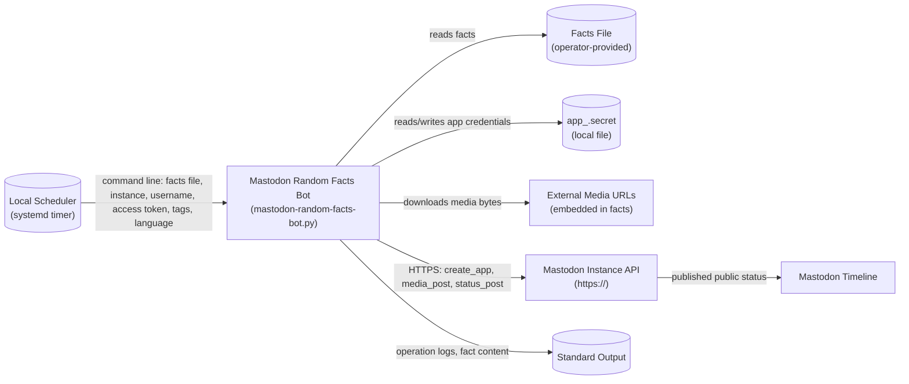
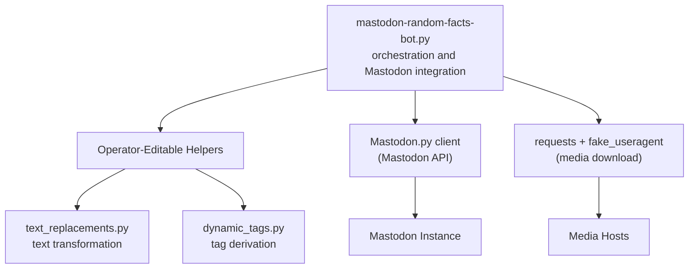
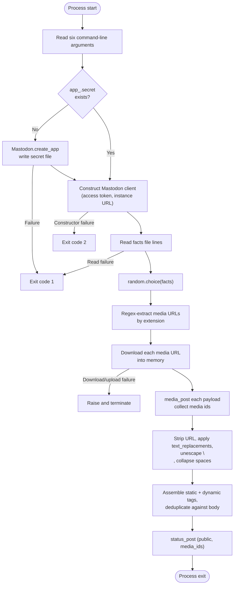
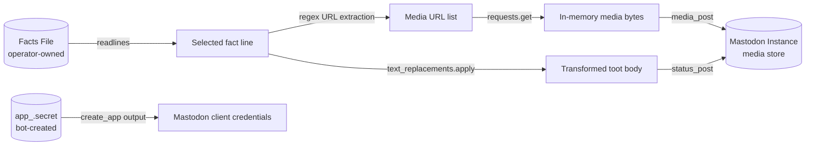
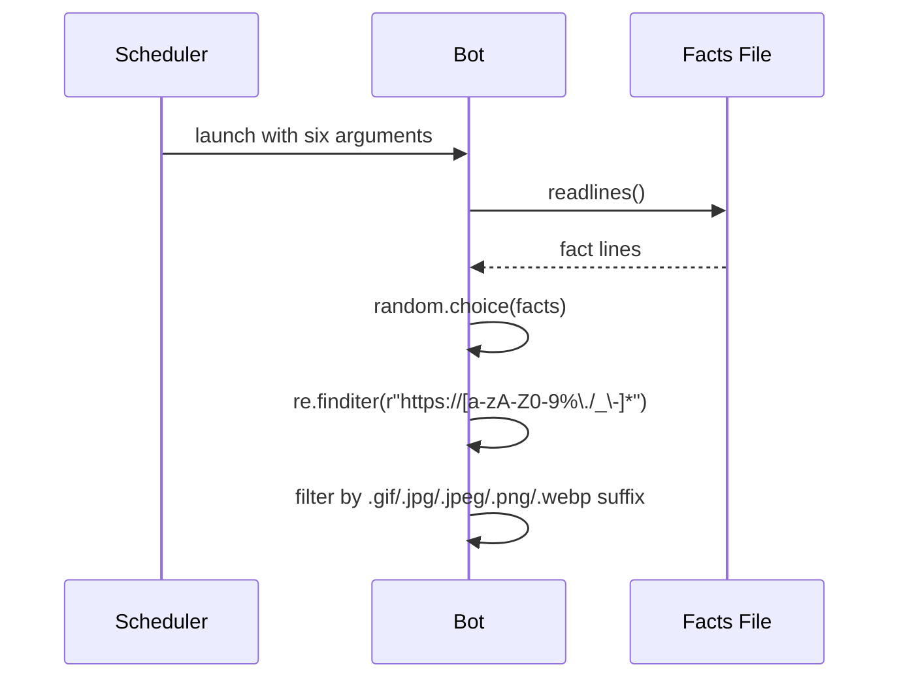
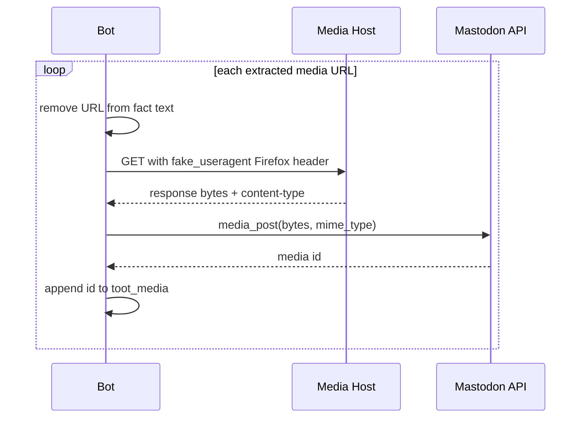
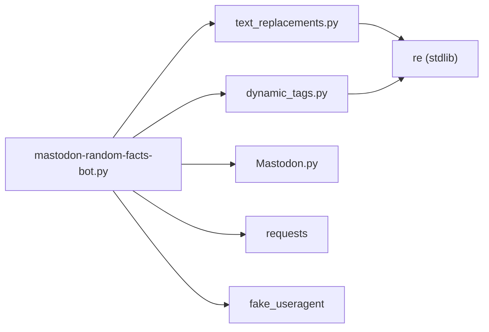

# Mastodon Random Facts Bot Architecture

This document describes the verified current architecture of Mastodon Random Facts Bot. It covers the system boundary, runtime process, component responsibilities, data flow, external integrations, and operational constraints of the bot as implemented in this repository. It does not describe a target or proposed design.

## 📑 Table of Contents

- [Purpose](#-purpose)
- [System Context](#-system-context)
- [Architectural Style](#-architectural-style)
- [Runtime Process](#-runtime-process)
- [Components](#-components)
- [Data Architecture](#-data-architecture)
- [Interfaces and Integrations](#-interfaces-and-integrations)
- [Key Processes](#-key-processes)
  - [Fact Selection and Media Extraction](#fact-selection-and-media-extraction)
  - [Media Download and Upload](#media-download-and-upload)
  - [Text Transformation and Tag Assembly](#text-transformation-and-tag-assembly)
  - [Status Publication](#status-publication)
- [Cross-Cutting Concerns](#-cross-cutting-concerns)
  - [Security and Privacy](#security-and-privacy)
  - [Error Handling](#error-handling)
  - [Observability](#observability)
  - [Configuration](#configuration)
  - [Concurrency and Resource Use](#concurrency-and-resource-use)
- [Dependency Direction and Rules](#-dependency-direction-and-rules)
- [External Dependencies](#-external-dependencies)
- [Deployment and Operations](#-deployment-and-operations)
- [Compatibility Contracts](#-compatibility-contracts)
- [Testing and Verification](#-testing-and-verification)
- [Design Constraints](#-design-constraints)
- [Extension Points](#-extension-points)
  - [Text Replacements](#text-replacements)
  - [Dynamic Tags](#dynamic-tags)
- [Source Map](#-source-map)
- [Related Documentation](#-related-documentation)

## 🎯 Purpose

Mastodon Random Facts Bot is a scheduled console pipeline that selects one fact from an operator-maintained local file, transforms its text, downloads and uploads any embedded media, and publishes the result as a public Mastodon status. The principal responsibility is the end-to-end orchestration of that single-post pipeline.

The architectural scope covers the Python entry point, its two operator-editable helper modules, the local secret and facts stores, and the outbound Mastodon API integration. The intended audience is the repository maintainer and contributors who need to locate ownership, follow the runtime flow, and evaluate the impact of a change. Recording these boundaries clarifies which parts are operator configuration, which are project code, and which are external service behaviour.

## 🌐 System Context

The system boundary is the bot process invoked on the operator's host. The initiating actor is the local scheduler (for example a `systemd` timer) that launches the process with six command-line arguments. The bot reads the facts file and the application secret file from the local working directory, downloads media from arbitrary HTTPS URLs embedded in facts, and exchanges application registration, media upload, and status publication requests with the configured Mastodon instance over HTTPS. The only persistent output is the published Mastodon status; operation logs and posted fact content are written to standard output.



The principal external boundaries are:
- **Local Scheduler:** Invokes the process periodically and supplies all configuration as command-line arguments. The scheduler owns the invocation schedule; the bot owns argument interpretation.
- **Facts File:** Operator-maintained local text file read at startup. The operator owns its content and lifecycle; the bot treats it as read-only input.
- **Application Secret File:** Local file `app_<instance>.secret` created once by the bot through `Mastodon.create_app` and reused on subsequent runs. The bot owns creation; the operator owns deletion and backup.
- **External Media URLs:** Arbitrary HTTPS hosts referenced inside fact text. The bot downloads their bytes into memory for upload; it does not persist them.
- **Mastodon Instance API:** Remote HTTPS endpoint that owns application registration, authentication, media storage, and status publication. The bot is an unauthenticated-at-registration, token-authenticated-at-posting client of this API.
- **Standard Output:** Operator-visible log stream owned by the hosting process; the bot writes progress and error messages but no structured telemetry.

## 🏗️ Architectural Style

The implementation is a single-process, sequential console batch pipeline with operator-editable extension modules. There is no long-lived service, queue, database, or web layer: the process starts, performs one ordered pass through selection, transformation, media handling, and publication, then exits. The repository demonstrates a procedural script composition style in which the entry point owns orchestration and delegates two well-defined transformation concerns to importable modules.



The principal architecture boundaries are:
- **Entry Point Orchestration:** `mastodon-random-facts-bot.py` owns argument parsing, secret-file bootstrap, API client construction, fact selection, media extraction, tag assembly, and status publication. It may import the two helper modules and the third-party clients, but the helpers must not import it.
- **Text Transformation Module:** `text_replacements.py` owns the `apply(text, language)` contract for operator-defined replacements. It depends only on the standard library and receives plain text in, returning plain text out.
- **Dynamic Tag Module:** `dynamic_tags.py` owns the `get(text, language)` contract for operator-defined tag derivation. It depends only on the standard library and returns a tag string or `None`.
- **External Client Boundary:** `Mastodon.py` and `requests` are the only network-facing collaborators. All outbound traffic is confined to the entry point; helper modules perform no I/O.

## 🔄 Runtime Process



The principal runtime sequence is:
1. The process starts and reads the six command-line arguments: facts file path, Mastodon instance, username, access token, tags to add, and language.
2. If `app_<instance>.secret` is absent, the bot registers an application via `Mastodon.create_app` and writes the secret file; otherwise it constructs the `Mastodon` client directly with the supplied access token.
3. The bot reads all fact lines, selects one at random, extracts media URLs by extension, downloads and uploads each media item, transforms the fact text, appends filtered tags, and publishes the status with `status_post`.

## 🧩 Components

| Component | Responsibility | Principal Dependencies | Lifetime or Ownership |
|-----------|----------------|------------------------|-----------------------|
| `mastodon-random-facts-bot.py` | Entry point and pipeline orchestration: argument handling, secret bootstrap, fact selection, media extraction, download and upload, tag assembly, status publication | `mastodon.Mastodon`, `requests`, `fake_useragent.UserAgent`, `text_replacements`, `dynamic_tags`, standard library | One-shot process owned by the local scheduler; exits after a single post or on failure |
| `text_replacements.py` | Operator-editable text transformation hook exposed as `apply(text, language)` | Standard library `re` only | Imported module; no independent lifetime; owned by the repository |
| `dynamic_tags.py` | Operator-editable dynamic tag derivation hook exposed as `get(text, language)` | Standard library `re` only | Imported module; no independent lifetime; owned by the repository |
| `Mastodon` client (`Mastodon.py`) | Application registration, media upload, and status publication against the Mastodon API | Mastodon instance over HTTPS | Constructed per run inside the entry point; not persisted beyond the process |
| Media downloader (`requests` + `fake_useragent`) | Fetch media bytes with a rotating Firefox user agent for upload | External media hosts over HTTPS | Per-media-call scope; response content held in memory only |

## 💾 Data Architecture

The bot owns no database. Meaningful state is limited to the operator-provided facts file, the locally persisted application secret file, and the in-memory fact and media payloads that flow through the pipeline. The Mastodon instance owns the published status and uploaded media after publication.



| Data or Store | Owner | Representation and Storage | Lifecycle or Consistency |
|---------------|-------|----------------------------|--------------------------|
| Facts file | Operator | Plain-text lines on the local filesystem at the path supplied as argument 1 | Created and revised by the operator; read-only to the bot; no caching or mutation |
| Application secret file | Bot (creation), operator (retention) | `app_<instance>.secret` in the working directory, written by `Mastodon.create_app` | Created once on first run; reused on subsequent runs; deleted only manually by the operator |
| Selected fact | Entry point | In-memory string chosen by `random.choice` | Exists for the duration of one run; discarded at exit |
| Media payloads | Entry point | In-memory bytes downloaded from fact-embedded URLs | Held only between download and `media_post`; never written to disk |
| Published status and media | Mastodon instance | Remote objects identified by returned IDs | Owned by the Mastodon instance after publication; the bot retains no local record |

## 🔌 Interfaces and Integrations

| Interface or Integration | Direction | Contract | Owner | Failure Semantics |
|--------------------------|-----------|----------|-------|-------------------|
| Command-line invocation | Inbound | Six positional arguments: facts file path, instance, username, access token, tags, language | Local scheduler | Missing or malformed arguments raise an unhandled `IndexError`; no argument validation layer exists |
| `Mastodon.create_app` | Outbound | `mastodon_username`, `api_base_url = https://<instance>`, `to_file = app_<instance>.secret` | Entry point | Returns falsy on failure: logs `Failed to create the application` and exits with code 1 |
| `Mastodon` client construction | Outbound | `access_token`, `api_base_url` | Entry point | Wrapped in `try`/`except`: logs `ERROR: Failed to log <username> into <instance>` and exits with code 2 |
| Facts file read | Inbound (local) | `open(facts_file_path, 'r').readlines()` | Entry point | Bare `except`: logs `ERROR: Failed to read the file` and exits with code 1 |
| Media download (`requests.get`) | Outbound | HTTPS GET with `User-Agent` from `fake_useragent` Firefox profile; `raise_for_status()` | Entry point | Exception is logged as `FAILURE!` and re-raised, terminating the process |
| `media_post` | Outbound | Bytes plus `mime_type` from the download response `content-type` header | Entry point | Same failure path as media download; no retry or fallback |
| `status_post` | Outbound | Body text, `media_ids`, `sensitive = False`, `visibility = 'public'`, no reply or spoiler | Entry point | Unhandled exception propagates and terminates the process with a traceback |

## 🔀 Key Processes

### Fact Selection and Media Extraction



The bot reads the entire facts file into memory, selects one line uniformly at random, and scans it with a URL regex. Only URLs whose lowercase suffix matches one of the five supported image extensions are retained; other URLs remain in the text. Selection is unconditional: the `while random_fact is None` loop terminates on the first iteration because `random.choice` never returns `None` for a non-empty list, and an empty facts file raises `IndexError`.

### Media Download and Upload



Each media URL is removed from the fact body before download so the published status contains no raw media links. Downloads are sequential, not parallel. A failed download or upload prints `FAILURE!` with the exception and re-raises, which aborts the run before any status is published; partial media uploads are not rolled back.

### Text Transformation and Tag Assembly

The selected fact is stripped of leading and trailing whitespace, passed through `text_replacements.apply(random_fact, language)`, the literal two-character sequence `\n` is converted to a newline, and runs of spaces are collapsed. The operator-supplied `tags_to_add` argument and the `dynamic_tags.get(toot_body, language)` result are concatenated, split on spaces, and filtered: tokens without `#` are kept verbatim, while `#`-prefixed tokens are appended only when neither the fact body nor the accumulated tag string already contains the lowercase tag followed by a space. The filtered tag string is appended to the body after a blank line.

### Status Publication

The final body, accumulated media IDs, and fixed publication parameters (`in_reply_to_id = None`, `sensitive = False`, `visibility = 'public'`, `spoiler_text = None`) are passed to `status_post`. The bot prints the fact body to standard output immediately before posting. No confirmation, deduplication, or rate-limit handling follows publication.

## 🧵 Cross-Cutting Concerns

### Security and Privacy

The trust boundary lies between the operator-controlled local environment and the remote Mastodon instance and media hosts. The access token and application secret are supplied as a command-line argument and a local file respectively; both are visible in the process listing and shell history, and the secret file persists in the working directory until manually deleted. Media URLs embedded in facts are treated as trusted operator input: their bytes are downloaded into memory and forwarded to Mastodon without content validation beyond the response `content-type` header. No credentials are logged.

### Error Handling

Failures are owned at the entry point with three distinct behaviours: application registration failure and facts-file read failure exit with code 1; client construction failure exits with code 2; media download or upload failure prints `FAILURE!` and re-raises, producing an unhandled traceback. There is no retry, backoff, fallback, or partial-post recovery. A failure at any stage prevents publication, so the bot never posts a fact without its intended media.

### Observability

The bot emits unstructured progress lines to standard output: application creation result, each media URL, upload success with the returned media ID, upload failure with the exception, and the final fact body. There are no metrics, traces, health checks, or log files. Diagnostic gaps include no record of the selected fact index, no timing information, and no persistent audit trail of published statuses.

### Configuration

| Configuration Area | Source | Responsibility | Supersede or Secret Policy |
|--------------------|--------|----------------|-----------------------------|
| Facts file path | Command-line argument 1 | Selects the read-only fact source | Operator-supplied; no default |
| Mastodon instance | Command-line argument 2 | Determines API base URL and secret file name | Operator-supplied; no default |
| Mastodon username | Command-line argument 3 | Names the registered application | Operator-supplied; no default |
| Mastodon access token | Command-line argument 4 | Authenticates `status_post` and `media_post` | Operator-supplied secret; visible in the process command line |
| Tags to add | Command-line argument 5 | Static hashtags appended to the post | Optional; empty string disables |
| Language | Command-line argument 6 | Selects text replacement and dynamic tag behaviour | Optional; consumed only by the operator-editable helper modules |
| Application secret | `app_<instance>.secret` in the working directory | Persists registered application credentials | Created by the bot on first run; never overwritten while present |

### Concurrency and Resource Use

The pipeline is strictly sequential and single-threaded. Media downloads and uploads execute in a loop with no parallelism, and the whole facts file plus each media payload are held in memory. Practical capacity is therefore bounded by the largest single media file and the facts file size, not by concurrency. The documented `systemd` unit sets `RuntimeMaxSec=60`, which bounds each invocation.

## 🧭 Dependency Direction and Rules

The entry point depends on the two helper modules and on the third-party clients; the helper modules depend only on the Python standard library and must not import the entry point, each other, or any network client. This direction keeps the operator-editable extension points free of orchestration and I/O concerns.



The principal dependency rules are:
- The entry point may import `text_replacements`, `dynamic_tags`, `mastodon`, `requests`, and `fake_useragent`; it owns all orchestration and network interaction.
- `text_replacements.py` and `dynamic_tags.py` may import only the standard library and must expose the stable `apply(text, language)` and `get(text, language)` signatures respectively.
- Helper modules must not import the entry point, instantiate Mastodon clients, or perform file or network I/O.
- Third-party packages are consumed only through the entry point; no transitive coupling between `Mastodon.py`, `requests`, and `fake_useragent` is introduced by project code.

## 📦 External Dependencies

| Dependency | Responsibility | Integration Boundary | Architectural Consequence |
|------------|----------------|----------------------|---------------------------|
| `Mastodon.py` | Application registration, media upload, and status publication against the Mastodon API | Entry point constructs the client and calls `create_app`, `media_post`, and `status_post` | The bot's outbound contract is bound to the Mastodon API surface; API changes affect the entry point directly |
| `requests` | Downloading media bytes from URLs embedded in facts | Entry point calls `requests.get` with a custom user agent header | Media availability depends on arbitrary third-party hosts; failures terminate the run |
| `fake_useragent` | Supplying a rotating Firefox user agent for media downloads | Entry point instantiates `UserAgent().firefox` per media item | Adds a network-fetching dependency for user agent data; its failure surfaces as a media download failure |
| `regex` | Declared in `requirements.txt` | Not imported by any project source file | Declared but unused; removal has no architectural effect |

## 🚀 Deployment and Operations

The bot deploys as a source checkout executed by a local scheduler on the operator's host. The repository documents a `systemd` timer and service pair in README.md: the timer activates the bot periodically (`OnBootSec=15min`, `OnUnitActiveSec=25min`) and the service runs it with `RuntimeMaxSec=60`. The process requires network access to the configured Mastodon instance and to any media hosts referenced by facts, write access to the working directory for the secret file, and read access to the facts file. Scaling is by schedule frequency, not by process concurrency; each invocation is independent and stateless apart from the secret file.

| Concern | Current Design | Architectural Consequence |
|---------|----------------|---------------------------|
| Process topology | One-shot console process launched by an external scheduler | No daemon, no in-process queue; failures are invisible until the next scheduled run |
| Persistent state | `app_<instance>.secret` in the working directory | Secret survives across runs; loss forces re-registration; exposure compromises the application |
| Scaling assumption | One post per invocation, sequential media handling | Throughput is bounded by the schedule interval and the slowest media upload |
| Availability | No retry, health check, or supervisor beyond the scheduler | A failing run is simply retried at the next timer activation |
| Operator-visible output | Unstructured standard output logs | Operators must inspect scheduler journals for diagnostics |

## 🛡️ Compatibility Contracts

| Contract | Owner | Invariant | Verification | Change Policy |
|----------|-------|-----------|--------------|---------------|
| Command-line argument order | Entry point | Six positional arguments in fixed order: facts file, instance, username, access token, tags, language | Manual invocation per README usage | Any reordering or addition breaks operator launch commands; treat as incompatible |
| `text_replacements.apply(text, language)` | `text_replacements.py` | Accepts fact text and language code, returns transformed text | Operator review of edited module | Signature and return type must remain stable for the entry point call site |
| `dynamic_tags.get(text, language)` | `dynamic_tags.py` | Accepts post body and language code, returns a tag string or `None` | Operator review of edited module | Signature and `None`-for-empty contract must remain stable |
| Secret file naming | Entry point | `app_<instance>.secret` in the working directory | File presence check at startup | Renaming or relocating invalidates existing registrations |
| Media URL recognition | Entry point | URLs matching `https://[a-zA-Z0-9%\./_\-]*` with `.gif`, `.jpg`, `.jpeg`, `.png`, or `.webp` suffixes are treated as media | Fact content review | Extending formats requires editing the suffix condition in the entry point |
| Mastodon API usage | Entry point via `Mastodon.py` | `create_app`, `media_post`, and `status_post` calls with the documented parameters | Successful scheduled runs | Mastodon API changes may require client or call-site updates |

## ✅ Testing and Verification

The repository contains no test suite, test framework, or CI workflow. Verification is manual: the operator installs dependencies, invokes the bot with a facts file and Mastodon credentials, and confirms that a status with the expected text, tags, and media appears on the target instance. Material coverage gaps include no automated regression protection for the pipeline, no validation of tag filtering or text transformation, and no failure-path testing for media download or API errors.

Execute the principal automated verification with:

```bash
python -m pip install -r requirements.txt
python mastodon-random-facts-bot.py <facts_file> <instance> <username> <access_token> "<tags>" <language>
```

The first command restores the declared dependencies; the second performs an end-to-end manual verification by publishing one fact. No further executable verification commands exist in the repository.

## ⚠️ Design Constraints

- **Sequential single-post pipeline:** One fact per process invocation with no batching, queueing, or parallel media handling; this keeps ownership simple but limits throughput to the scheduler cadence.
- **No argument validation:** The six command-line arguments are consumed positionally without checks, so misconfiguration surfaces as an unhandled exception rather than a guided error.
- **In-memory media handling:** Media bytes are held entirely in memory between download and upload, bounding the bot by the largest single media file and by the 60-second `RuntimeMaxSec` documented in the systemd unit.
- **Trusted fact content:** Media URLs and text within facts are treated as trusted operator input; no sanitisation, allow-listing, or content-type verification beyond the response header is performed.
- **No publication safety net:** Absence of retries, deduplication, or rate-limit handling means transient Mastodon or media-host failures abort the run and defer posting to the next scheduled activation.
- **Secret exposure surface:** The access token travels as a command-line argument and the application secret persists as a working-directory file; both are operator-managed and outside the bot's control.
- **Unused declared dependency:** `regex` is declared in `requirements.txt` but imported by no source file, leaving a declared-but-inert dependency.

## 🔧 Extension Points

### Text Replacements

1. Implement or revise the replacement logic inside `text_replacements.apply(text, language)`.
2. Integrate the implementation by editing `text_replacements.py` in place; no registration step exists because the entry point imports the module directly.
3. Add the verification required to preserve neighbouring contracts by confirming that the function still accepts `(text, language)` and returns a string.

The extension must preserve the function signature, the plain-text-in and plain-text-out contract, and the standard-library-only dependency rule. The language argument is the designated mechanism for locale-specific behaviour.

### Dynamic Tags

1. Implement or revise the tag derivation logic inside `dynamic_tags.get(text, language)`.
2. Integrate the implementation by editing `dynamic_tags.py` in place; the entry point calls it after text transformation.
3. Add the verification required to preserve neighbouring contracts by confirming that the function returns either a space-prefixed tag string or `None` when no tags apply.

The extension must preserve the signature, the `None`-for-empty contract consumed by the entry point's `if dynamic_tags_to_add:` check, and the standard-library-only dependency rule.

## 🗺️ Source Map

| Area | Path |
|------|------|
| Entry point and pipeline orchestration | `mastodon-random-facts-bot.py` |
| Text transformation extension point | `text_replacements.py` |
| Dynamic tag extension point | `dynamic_tags.py` |
| Declared runtime dependencies | `requirements.txt` |
| Operator deployment example (systemd) | `README.md` |
| Licence | `LICENSE` |

## 📚 Related Documentation

- [README.md](./README.md) documents user-facing usage, including the `systemd` timer and service deployment example.
- [CONTRIBUTING.md](./CONTRIBUTING.md) defines contribution workflow, prerequisites, and pull request guidelines.
- [PRIVACY.md](./PRIVACY.md) describes the data categories, storage locations, and retention behaviour relevant to the architecture's trust boundaries.
- [SECURITY.md](./SECURITY.md) defines supported versions, vulnerability reporting, and the security scope covering the application code and its dependencies.
- [CODE_OF_CONDUCT.md](./CODE_OF_CONDUCT.md) states the conduct standards for project spaces.