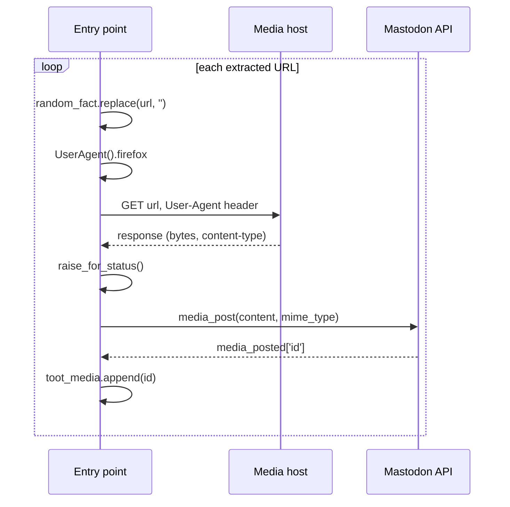

# Flow: media handling

This flow documents how media URLs embedded in fact text are discovered, downloaded, uploaded, and removed from the published body. It is a sub-flow of [Startup and posting cycle](./startup-and-posting-cycle.md).

## Trigger

Media handling begins after fact selection, when the entry point scans the selected fact for URLs.

## URL extraction

```python
for p in re.finditer(r"https://[a-zA-Z0-9%\./_\-]*", random_fact):
    media_url = p.group(0)
    if (media_url.endswith('.gif') or
        media_url.endswith('.jpg') or
        media_url.endswith('.jpeg') or
        media_url.endswith('.png') or
        media_url.endswith('.webp')):
        media_urls.append(media_url)
```

### Extraction rules

- The regex matches `https://` followed by characters from the set `a-z A-Z 0-9 % . / _ -`. It does not match `http://`, query strings containing `?` or `&`, URL fragments containing `#`, or URLs with other special characters.
- The suffix filter is case-sensitive: `.JPG` or `.PNG` are not recognised.
- URLs that do not match a supported suffix remain in the fact text and are published as plain text.
- Each extracted URL is printed to standard output (`URL <url>`).

### Consequences

- A fact containing a supported image URL publishes the image as an attachment and removes the URL from the text.
- A fact containing an unsupported URL (wrong scheme, wrong extension, or characters outside the regex set) publishes the URL as text.
- A fact containing a URL with a query string truncates the match at the `?`, which typically breaks the download.

## Download and upload



### Ordering

For each media URL, in list order:

1. The URL is removed from the fact text with `str.replace`. This happens before the download, so a failed download still leaves the URL removed from the in-memory text; however, because any failure aborts the run, the modified text is never published.
2. A fresh `UserAgent` instance is created and its `.firefox` property is read.
3. The URL is fetched with `requests.get` and the Firefox user agent header.
4. `raise_for_status()` converts HTTP errors to exceptions.
5. The response bytes and the response `content-type` header are passed to `media_post`.
6. The returned media ID is appended to `toot_media`.
7. Success is printed (`   > SUCCESS! <id>`).

### Failure handling

Any exception in steps 2 through 5 is caught, printed as `   > FAILURE! <exception>`, and re-raised. The process terminates. Consequences:

- No status is published.
- Media uploaded in earlier iterations remains on the Mastodon instance as orphaned media.
- The next scheduled invocation starts fresh and may re-attempt the same fact.

There is no retry, no timeout configuration, no size limit, and no content validation beyond the response `content-type` header forwarded to Mastodon.

## Body sanitisation

After the media loop, the fact text no longer contains any supported media URL. The remaining text is stripped, transformed, and published. The removal is exact string replacement, so a URL appearing multiple times in the fact is removed each time.

## Data crossing the boundary

| Boundary | Outbound | Inbound |
|----------|----------|---------|
| Media host | URL, Firefox user agent | Response bytes, `content-type` header |
| Mastodon API | Media bytes, MIME type | Media ID |

## Invariants

- Every supported media URL in the selected fact is attempted exactly once, in order of appearance.
- A supported media URL never appears in the published body.
- The number of `media_ids` passed to `status_post` equals the number of successful uploads.
- A failed media item prevents publication entirely; there is no partial media set.

## Modification impact

- Adding a supported extension requires editing the suffix condition.
- Changing the regex affects which URLs are recognised; for example, adding `?` to the character class would preserve query strings.
- Adding retries or timeouts requires wrapping the `requests.get` call; the current design deliberately defers failure to the next scheduled run.
