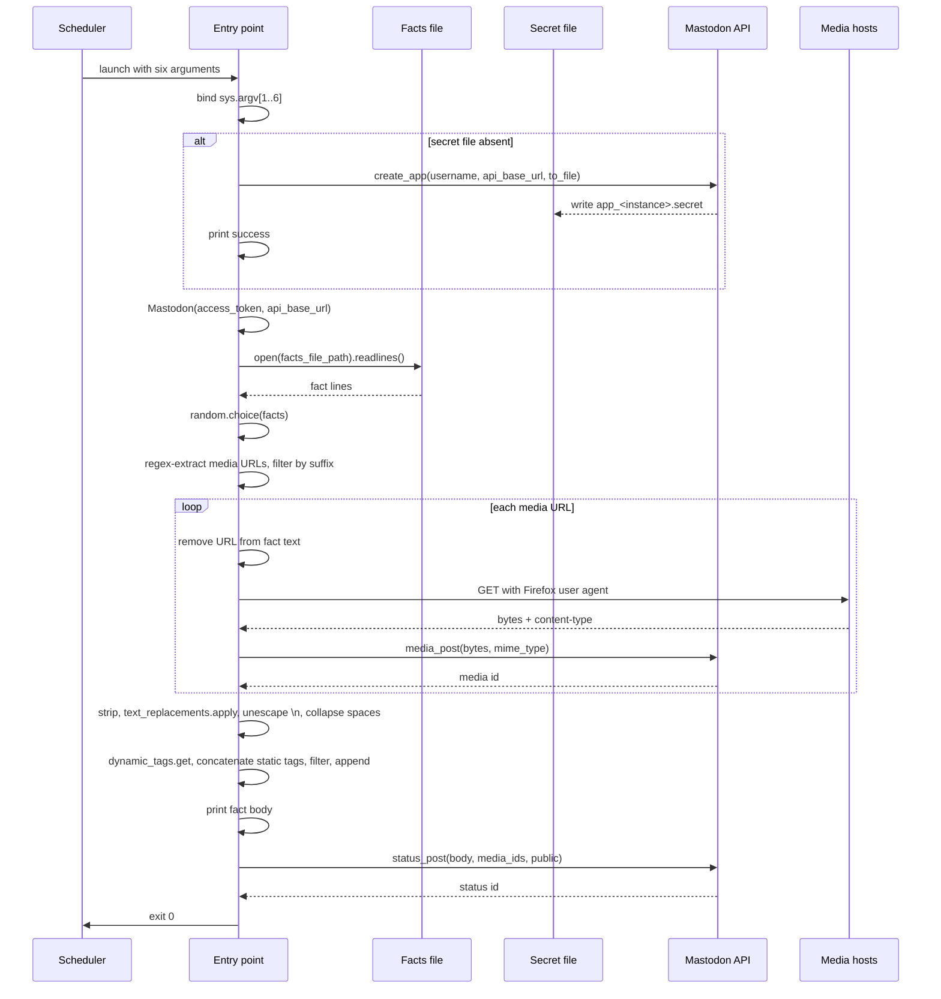

# Flow: startup and posting cycle

This flow documents the complete end-to-end execution of one bot invocation, from scheduler launch to status publication or failure. It is the causal spine of the system; the media, text, and tag sub-flows are elaborated in their own documents.

## Trigger

An external scheduler (for example a `systemd` timer) launches the process:

```bash
python mastodon-random-facts-bot.py <facts_file> <instance> <username> <access_token> "<tags>" <language>
```

The scheduler owns the cadence. The bot owns exactly one posting cycle per invocation.

## Sequence



## Stage-by-stage causal chain

1. **Argument binding.** The six positional arguments are bound to local names. No validation occurs. A missing argument raises `IndexError` and terminates with a traceback.
2. **Secret bootstrap.** The presence of `app_<instance>.secret` is tested with `os.path.isfile`. Absence triggers `Mastodon.create_app`, which registers an application on the instance and writes credentials to the secret file. A falsy return exits with code 1. Presence skips registration entirely; the existing file is reused without verification.
3. **Client construction.** The `Mastodon` client is constructed with the access token and instance URL. Construction failure exits with code 2. Note that construction does not perform a network round trip in `Mastodon.py`; authentication failures surface later, at the first API call.
4. **Facts read.** The facts file is read into a list of lines. Read failure exits with code 1. The lines retain their trailing newlines until the selected fact is stripped at stage 8.
5. **Fact selection.** `random.choice` selects one line. The `while random_fact is None` loop is effectively a no-op because `random.choice` never returns `None` for a non-empty list. An empty facts file raises `IndexError`.
6. **Media extraction.** A regex finds all `https://` URLs in the selected fact. Only URLs whose suffix matches `.gif`, `.jpg`, `.jpeg`, `.png`, or `.webp` are retained. The suffix check is case-sensitive.
7. **Media handling.** Each retained URL is removed from the fact text, downloaded into memory, and uploaded to Mastodon. The returned media IDs are collected. Any failure aborts the run before publication. See [Flow: media handling](./media-handling.md).
8. **Text transformation.** The fact is stripped, passed through `text_replacements.apply`, the literal `\n` sequence is converted to a newline, and runs of spaces are collapsed. See [Flow: text transformation and tag assembly](./text-transformation-and-tag-assembly.md).
9. **Tag assembly.** Static and dynamic tags are concatenated, filtered against the body and each other, and appended after a blank line.
10. **Publication.** The body is printed, then `status_post` publishes a public status with the collected media IDs. Failure is unhandled.
11. **Exit.** The process exits with code 0.

## Alternate paths

- **No media in fact.** The media loop body never executes; `toot_media` remains empty; `status_post` is called with an empty `media_ids` list.
- **No tags.** When both `tags_to_add` and the dynamic tags result are empty, `all_tags_to_add` remains `''`, the filtering block is skipped, and no tag line is appended.
- **Secret file already present.** Registration is skipped; the client is constructed directly.
- **First run on a new instance.** Registration runs, writes the secret file, and the client is constructed in the same invocation.

## Failure paths

| Stage | Failure | Consequence |
|-------|---------|-------------|
| Argument binding | Missing argument | `IndexError`, traceback, non-zero exit |
| Secret bootstrap | `create_app` falsy | Message, exit 1 |
| Client construction | Constructor raises | Message, exit 2 |
| Facts read | File missing or unreadable | Message, exit 1 |
| Fact selection | Empty facts file | `IndexError`, traceback |
| Media handling | Download or upload error | `FAILURE!` message, re-raise, traceback |
| Publication | `status_post` error | Unhandled traceback |

In every failure case, no status is published. The scheduler's next activation is the implicit retry. See [Error handling](../error-handling.md).

## Invariants preserved

- At most one status is published per invocation.
- A status is published only when the complete pipeline succeeds.
- A published status never contains raw media URLs (they are removed before upload).
- A published status never contains duplicate hashtags.
- The secret file is created at most once per instance.
