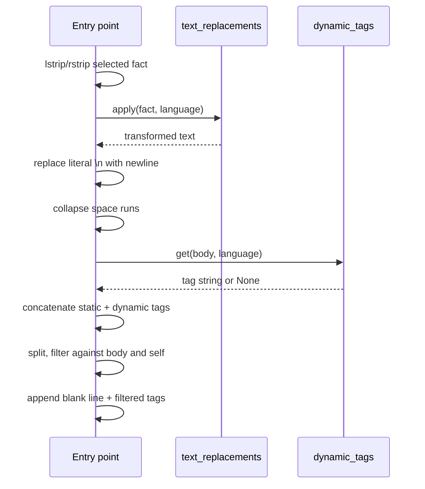

# Flow: text transformation and tag assembly

This flow documents how the selected fact becomes the final published body: whitespace normalisation, operator-defined text replacement, escape conversion, static and dynamic tag assembly, and tag filtering. It is a sub-flow of [Startup and posting cycle](./startup-and-posting-cycle.md).

## Trigger

The flow begins after all media URLs have been removed from the fact text and all media has been uploaded.

## Text transformation

### Step 1: strip

```python
random_fact = random_fact.lstrip().rstrip()
```

Leading and trailing whitespace, including the trailing newline from `readlines()`, is removed.

### Step 2: operator replacement

```python
toot_body = text_replacements.apply(random_fact, language)
```

The stripped fact is passed to the operator-editable `text_replacements.apply` hook. The shipped implementation is the identity function; see [Components: text replacements](../components/text-replacements.md). The `language` argument is available for locale-specific behaviour.

### Step 3: escape conversion

```python
toot_body = toot_body.replace(r'\n', '\n')
```

The literal two-character sequence backslash-n is replaced with a real newline. This allows facts to encode line breaks in a single-line facts file.

### Step 4: whitespace collapse

```python
toot_body = re.sub(r'\ \ *', ' ', toot_body)
```

Runs of two or more spaces are collapsed to a single space. The pattern matches a space followed by zero or more spaces, so any run of two or more spaces becomes one space. Single spaces are unaffected. Newlines are unaffected.

## Tag assembly

### Step 5: dynamic tag derivation

```python
dynamic_tags_to_add = dynamic_tags.get(toot_body, language)
```

The transformed body is passed to the operator-editable `dynamic_tags.get` hook. The shipped implementation returns `None`; see [Components: dynamic tags](../components/dynamic-tags.md).

### Step 6: concatenation

```python
all_tags_to_add = ''
if tags_to_add: all_tags_to_add += ' ' + tags_to_add
if dynamic_tags_to_add: all_tags_to_add += ' ' + dynamic_tags_to_add
```

The static `tags_to_add` argument and the dynamic result are concatenated, each prefixed with a space when non-empty. When both are empty, `all_tags_to_add` remains `''` and the filtering block is skipped entirely.

### Step 7: filtering

```python
for tag in all_tags_to_add.split(' '):
    if '#' not in tag:
        filtered_tags_to_add += ' ' + tag
        continue
    if (tag.lower() + ' ' not in toot_body.lower() + ' ' and
        tag.lower() + ' ' not in filtered_tags_to_add.lower() + ' '):
        filtered_tags_to_add += ' ' + tag
```

The concatenated string is split on spaces. Each token is classified:

- **Tokens without `#`** are kept verbatim. This preserves any non-tag text the operator included in the `tags_to_add` argument.
- **Tokens with `#`** are kept only when both conditions hold:
  1. The lowercase tag followed by a space does not appear in the lowercase body followed by a space.
  2. The lowercase tag followed by a space does not appear in the accumulated filtered string followed by a space.

The trailing-space trick ensures that a tag which is a prefix of another tag (for example `#art` versus `#artificial`) is not falsely detected as a duplicate.

### Step 8: append

```python
toot_body += '\n\n' + filtered_tags_to_add.strip()
```

The filtered tag string is stripped of leading and trailing spaces and appended after a blank line.

## Sequence



## Data transformations

| Step | Input | Output | Notes |
|------|-------|--------|-------|
| Strip | Fact line with newline | Trimmed fact | Removes `readlines()` newline |
| Replace | Trimmed fact | Transformed body | Operator-defined; identity by default |
| Unescape | Body with `\n` literals | Body with real newlines | Enables multi-line facts |
| Collapse | Body with space runs | Body with single spaces | Newlines preserved |
| Derive | Body, language | Tag string or `None` | Operator-defined; `None` by default |
| Concatenate | Static tags, dynamic tags | Combined tag string | Space-prefixed segments |
| Filter | Combined tags, body | Filtered tag string | Case-insensitive deduplication |
| Append | Body, filtered tags | Final toot body | Blank line separator |

## Invariants

- The published body never contains a duplicate hashtag.
- A hashtag already present in the fact body is not re-appended.
- Non-tag tokens in the `tags_to_add` argument are preserved verbatim.
- The tag block is separated from the body by exactly one blank line.
- When no tags apply, no trailing blank line or tag block is appended.

## Failure semantics

An exception in `text_replacements.apply` or `dynamic_tags.get` propagates unhandled and terminates the process before publication. The filtering logic itself cannot raise under normal string inputs.

## Modification impact

- Changing the escape sequence (for example, supporting `\t`) requires editing the entry point's replace call.
- Changing the deduplication logic affects which hashtags appear in the published status.
- Changing the separator (currently `'\n\n'`) changes the visual layout of the published post.
